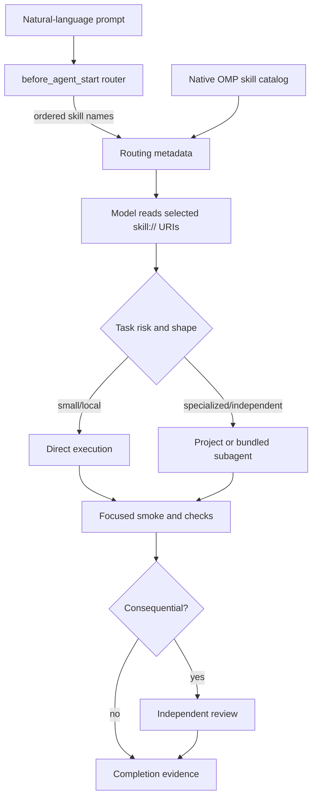

# Architecture

## Decision

Use OMP-native discovery for context, skills, agents, and extension loading. Add one small extension only for deterministic prompt classification; keep all engineering procedures in skills.

## Boundaries

### Governance

`AGENTS.md` is always-on policy: truth discipline, authority, proportional gates, execution lifecycle, and completion contract. It is guidance, not executable enforcement.

### Routing

`.omp/extensions/prompt-router.ts` owns deterministic classification. It:

- evaluates only top-level prompts (`ctx.agent.kind === "main"`);
- selects an ordered, de-duplicated skill list;
- injects no skill body and performs no I/O, preserving progressive disclosure;
- suppresses consecutive duplicate route messages in one session;
- exports its classifier for direct execution by `tests/runtime-router-check.ts` under OMP's embedded Bun runtime.

The extension cannot prove that a model followed a skill. It makes selection deterministic and visible to the model; OMP's normal tool trace provides activation evidence when the model reads `skill://...`.

### Skills

Seven skills divide decisions by failure mode rather than technology checklist:

1. `engineering-core` — investigation, change discipline, tests, review, and completion.
2. `architecture-systems` — boundaries, contracts, consistency, migration, capacity, and failure modes.
3. `blockchain-systems` — indexers, reorgs, RPC, transactions, cross-chain, and simulation.
4. `smart-contract-defi-security` — contract threats, economic invariants, DeFi execution, and ecosystem-specific checks.
5. `backend-concurrency-performance` — APIs, concurrency, jobs, databases, profiling, and regression control.
6. `production-sre` — Kubernetes/EKS, IaC, observability, SLOs, incidents, rollout, rollback, and recovery.
7. `agent-workflow-engineering` — skill/agent design, prompt injection, authorization, MCP, routing, evaluation, and cost.

### Models

`.omp/config.yml` maps stable OMP roles to exact installed `openai-codex` selectors. Frequent main and implementation work uses GPT-6 Luna at medium effort; bounded side work uses Luna at low or medium effort. Explicit deep reasoning, planning, and high-risk advice use GPT-6.1 Terra at high effort, preserving a 500K-context tier without paying GPT-6.1 Sol's 2× Terra rate. Sol is intentionally unused. The bundled writable `task` agent is the implementation role, so a second project `implementer` would add naming and maintenance surface without a distinct capability boundary.

### Agents

Project agents complement OMP's bundled agents. The top-level session remains integration owner. `architect`, `sre`, and `smart-contract-auditor` receive only `read`, `grep`, and `glob`; command execution, network access, and repository writes remain with the authorized parent.

| Agent | Ownership | Repository writes | Model role | Review condition |
|---|---|---:|---|---|
| `architect` | System boundaries and implementable decision records | No | `@plan` | Review for high-impact architecture |
| `test-engineer` | Behavioral, invariant, concurrency, and failure tests | Yes | `@task` | Implementation owner integrates |
| `sre` | Static reliability and deployment-safety assessment | No | `@slow` | Required for production-critical change |
| `smart-contract-auditor` | Static contract/economic exploitability | No | `@slow` | Required for fund/authorization risk |
| bundled `scout` | Rapid read-only exploration | No | `@smol` | Parent verifies findings |
| bundled `reviewer` | Patch correctness | No | `@slow` | Consequential changes |
| bundled `security-reviewer` | General repository security | No | runtime-defined | Security-sensitive changes |
| bundled `task` | Scoped implementation and general writable work | Yes | `@task` | Parent verifies output |

### Validation

`scripts/validate_template.py` first rejects symlinks, oversized files, and unsafe modes in template-owned paths, then enforces required files, the canonical model-role mapping, Agent Skills metadata, one-level layout, duplicate names, contained references, agent metadata/capability boundaries, routing-rule integrity, scenario coverage, and configuration omissions. `tests/test_prompt_router.py` checks a dependency-free Python oracle over the shared JSON. `tests/runtime-router-check.ts`, launched by `scripts/test_runtime_router.py`, executes the actual TypeScript classifier and stateful handler under OMP's embedded Bun runtime in headless RPC mode.

## Failure behavior

- Router exception: OMP extension handler reports failure; native semantic skill discovery remains available. The router itself has no I/O path expected to fail.
- Unknown skill: validator fails before delivery; OMP would otherwise leave the URI unresolved.
- Unavailable configured model: installed OMP reports the selector as unresolved; update `.omp/config.yml` only after checking `omp models --json`. No fallback is treated as equivalent.
- Agent collision: validator rejects duplicate project names and project names that unnecessarily replace bundled specialists.
- Parallel conflict: governance permits parallel readers in one tree, serializes writers in one working tree, and requires isolated worktrees plus one integration owner for justified parallel writers.
- Missing external tool/MCP: agents state the capability gap and use the closest supported local method; they never claim an unavailable tool ran.
